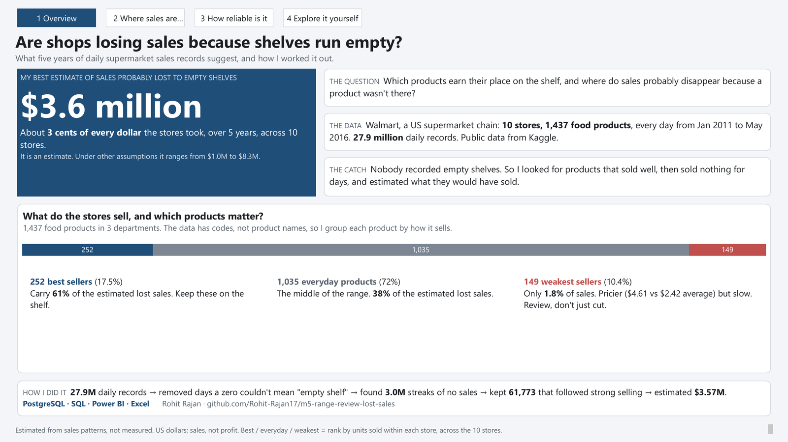
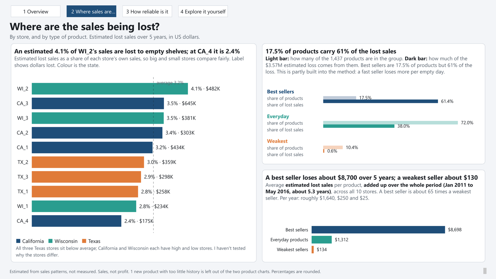
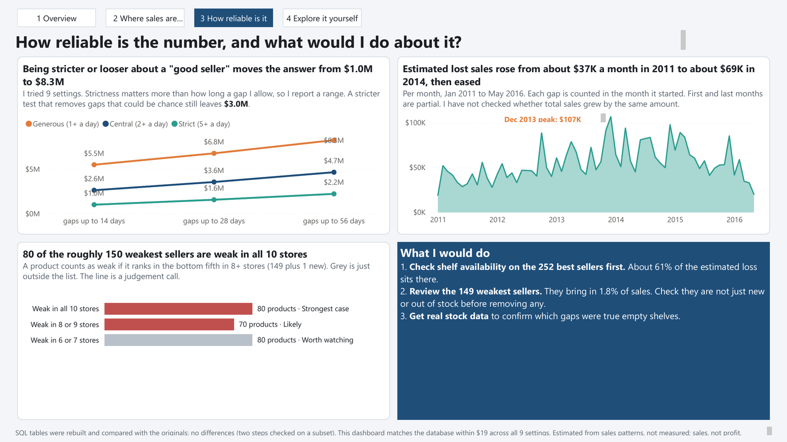
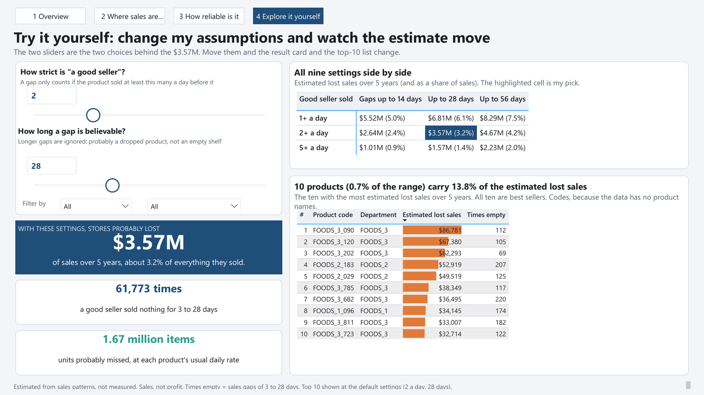

# Range review and lost sales from likely stockouts

**Which products earn their place on the shelf, store by store, and where are sales probably being lost to empty shelves?**

An entry-level data analysis project on the public Walmart M5 retail dataset (Foods category). Built with PostgreSQL, Power BI and Excel.

> Author: Rohit Rajan · [LinkedIn](https://www.linkedin.com/in/rohit-rajan17) · Data: US retail, 2011 to 2016. This is a portfolio exercise, not a UK finding.

## Headline result

- Zero-sales days are normal in this data, so a zero alone proves nothing.
- I looked only at runs of 3 to 28 zero-sales days that followed steady selling (2 or more units a day before the run).
- On that rule, an estimated **$3.57 million** of sales (3.2% of $111.13 million revenue) was probably lost to empty shelves.
- That figure depends on my settings. Across nine reasonable settings it runs from **$1.0 million to $8.3 million** (0.9% to 7.5% of revenue).
- Some short gaps could be chance. A stricter test that keeps only gaps where usual daily sales x days empty is at least 12 items keeps 83% of the dollars: a conservative floor of about **$3.0 million** ($2.97M).
- 252 of 1,437 products (17.5%) account for 61.4% of the estimated lost revenue. These are the products I would check availability on first.
- 149 products (10.4%) are cut candidates: bottom fifth of their store in 8 or more of the 10 stores, with at least a year of history. They account for 0.6% of the estimated lost revenue.

This is an estimate. The data has no stock levels, so no stockout was observed. See [limits](#limits).

## How it works

1. **Load** the raw files into PostgreSQL.
2. **Clean.** Remove days when a zero does not mean "out of stock": store closures, days before a product first sold in that store, and days when a whole store was disrupted.
3. **Range review.** Rank products in fifths inside each store, by units and by revenue. Label each product protect, keep, cut candidate or review (too new to judge).
4. **Find zero runs.** Use a gaps-and-islands query to find every run of consecutive zero-sales days.
5. **Estimate lost sales.** Lost units = average daily sales before the run x run length. Value them at the product's average price in that store.
6. **Test the settings.** Change the minimum sales rate and the longest run counted, and show how much the answer moves.
7. **Report.** A four-page Power BI report with controls for the two settings, and an Excel workbook that reproduces the totals as a cross-check.

## Report pages

| | |
|---|---|
|  |  |
|  |  |

## Repository

| Folder | What is in it |
|---|---|
| `sql/` | Twelve numbered SQL scripts, 01 to 12, run in order. Each one lists the results it should return |
| `docs/WRITEUP.md` | Method, results, checks and limits |
| `docs/DATA_DICTIONARY.md` | Tables and definitions |
| `screenshots/` | The four Power BI report pages |

The raw data, derived tables and the Power BI file are not in this repository. Download the data from Kaggle: [M5 Forecasting - Accuracy](https://www.kaggle.com/competitions/m5-forecasting-accuracy/data) and follow its terms.

## How the numbers were checked

- The tables from scripts 02, 03, 05 to 09 and 11 were rebuilt in a separate schema and compared with the originals in both directions, with zero differences. Scripts 02 and 03 were proved on a subset because the full run was too slow. The queries in script 10 matched the Excel workbook. Script 01 (load) and script 04 (data-quality checks) were not re-run.
- The totals were reproduced in Excel (revenue $111,130,675.60, 45,918,175 units).
- Power BI measures were checked against SQL on a 3 x 3 grid of settings. The largest difference is $19, from rounding in the exported columns.

## Limits

- **No stock data.** A run of zero sales is only a sign of a possible stockout. It can also be a delisting, a supplier problem or a quiet week.
- **The rule cannot see slow sellers.** It only counts runs after steady selling, so a low lost-sales figure for a product is not proof that it never ran out.
- **Thresholds are judgement calls:** 8 of 10 stores, 365 days of history, 2 units a day, a 28-day cap. The minimum rate and the cap are stress-tested in the write-up. The 365-day line, the 28-day look-back and the 3-day minimum run were not tested.
- **The "before" rate is a floor.** It includes the product's own earlier zero days.
- **Some gaps may be chance.** Script 12 tests this with a simple random-sales model and a 12-item line that is my judgement. Real sales are clumpier than the model.
- **Low prices not investigated.** 28,729 Foods price rows are under $0.50. They affect revenue only.
- **One average price per product and store**, over the whole period. Price changes inside a run are ignored.
- **Revenue and units, not profit.** There is no cost or margin data.
- **US data from 2011 to 2016.** The method transfers. The numbers do not.

## Tools

PostgreSQL and DBeaver for the SQL (CTEs, window functions, gaps-and-islands, `unnest WITH ORDINALITY`), Excel for the cross-check (`SUMIFS`, `INDEX`/`MATCH`, `COUNTIFS`), Power BI Desktop for the report (star schema, `SUMX` measures, what-if parameters).
